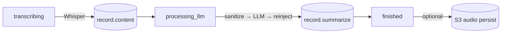

# AddOn-System (Pipeline-Erweiterungen)

Design für optionale Nachverarbeitungs-AddOns, die nach einer Pipeline-Stufe
auf den KI-bearbeiteten Text laufen — z. B. eine Plausibilitäts-/Medikations-Prüfung
der Zusammenfassung. Ziel: ein neues AddOn wird per **Admin-UI** angelegt, nicht
durch Codeänderung.

> Status: Planung. Phase 0 (nur `sync_rpc`) ist der erste Umsetzungsschritt.

---

## Status quo — und warum heute Code angefasst werden muss

Die Hauptpipeline ist die lineare Funktion `background_transcription_task`
(`backend/components/services/background_transcription_service.py:174`),
gestartet von `finalize` / `/upload` / Retry je über `asyncio.to_thread(...)`
→ läuft im Threadpool, blockierende HTTP-Calls sind erlaubt.



Zwei Hürden verhindern heute "AddOns ohne Code":

1. **Kein Hook/Registry.** Jede Stufe ist hart eincodiert. Das PII-Addon
   (EntityGuard) ist genau die Form, die ein AddOn heute hätte: eigenes
   Service-Modul + Config-Flag in `LlmSettingsModel` + ein `if enabled:`-Block
   inline in der Pipeline.
2. **Drei Kopien** des `sanitize → LLM → reinject`-Musters:
   `background_transcription_task`, eine zweite in `record.py` (on-demand
   Re-Summarize) und `chunk_correction_service.py` (Live-Chunks). Ein
   Inline-AddOn müsste an allen relevanten Stellen eingebaut werden.

Das AddOn-System löst beides durch einen **generischen Vertrag** und einen
**Dispatcher**, dessen Transport pro AddOn als Config-Eigenschaft wählbar ist.

---

## Transport-Modi (pro AddOn umschaltbar)

Die Pipeline kennt nur **einen** Aufruf: `dispatch_addons(stage, ctx, db)`.
Darin wird nach `AddonConfig.mode` verzweigt:

| `mode` | Ablauf | Ergebnis kommt zurück via |
|---|---|---|
| `sync_rpc` | blockierender POST, Antwort im selben Call (EntityGuard-Stil) | sofort, im Response |
| `fire_forget` | POST abfeuern, nicht warten (Task/Thread), weiterlaufen | gar nicht / späterer Kanal |
| `async_callback` | POST mit `record_id`+Token, nicht warten; AddOn POSTet später Ergebnis | **inbound Callback-Endpunkt** |
| `queue` *(später)* | Publish auf Redis-Channel; externer Consumer verarbeitet, published zurück | Redis-Subscriber |

Neue AddOns = eine Zeile in `AddonConfig` (DB, via Admin-UI) — kein Code,
kein Redeploy. Das ist der eigentliche "dynamisch"-Payoff.

> Webhooks sind einzeln eine Richtung. Praxislösung: entweder *eine synchrone
> RPC pro Aufruf* (EntityGuard-Stil, schnelle Checks) oder *zwei Webhooks /
> eine Queue* (async/late Results).

---

## Datenmodell

### `AddonConfig` (Liste, keine Singleton-Zeile)

Spiegelt `AudioSettingsModel` / `LlmSettingsModel`, aber als Liste statt
Singleton.

| Feld | Typ | Hinweis |
|---|---|---|
| `id` | PK | |
| `name` | str, unique + idx | z. B. `medication_check` |
| `endpoint` | str | volle URL, wie `sanitizer_endpoint` (kein Pfad wird angehängt) |
| `mode` | str | `sync_rpc` \| `fire_forget` \| `async_callback` *(Phase 0: nur `sync_rpc` aktiv)* |
| `stage` | str | `post_summary` \| `post_transcription` *(Phase 0: nur `post_summary`)* |
| `enabled` | bool | default `False` |
| `fail_mode` | str | `soft` \| `hard`, default `soft` |
| `sees_pii` | bool | default `False` → AddOn bekommt anonymisierten Text |
| `timeout_s` | int | default `30` |
| `auth_token` | str \| None | Callback-Verifikation / Bearer |
| `contract_version` | int | default `1` |
| `created_at` / `updated_at` | datetime | |

### `RecordAddonResult` (Seitentabelle)

Sodass N AddOns **keine** Schema-Migration pro AddOn brauchen.

| Feld | Typ | Hinweis |
|---|---|---|
| `id` | PK | |
| `record_id` | FK `records.id`, idx | |
| `addon_name` | str, idx | |
| `status` | str | `pending` \| `ok` \| `warn` \| `error` \| `timeout` |
| `payload` | `EncryptedString` | JSON-Blob (`findings`/`score`/…) — Patientenbezogen → verschlüsselt |
| `run_id` | str \| None | Korrelation für Callback-Dedupe (idempotent) |
| `created_at` | datetime | |

---

## Generischer Vertrag (fest, nicht vom Admin verfasst)

Die App schickt **immer** dieselbe JSON-Form. Der Admin gibt nur URL + Modus +
Flags an; `sees_pii` steuert z. B., ob echter oder anonymisierter Text enthalten
ist.

**Outbound** `POST {endpoint}`:
```json
{
  "contract_version": 1,
  "record_id": 123,
  "run_id": "<uuid>",
  "stage": "post_summary",
  "category": "kardiologie",
  "anonymized": false,
  "content": "<transkript>",
  "summary": "<llm-summary>",
  "callback_url": "https://host/api/v1/addons/<name>/result/<token>"
}
```
`callback_url` nur beim Modus `async_callback`.

**Result** (sync_rpc-Response bzw. späterer Callback):
```json
{ "status": "ok|warn|error", "findings": [...], "score": 0.92, "payload": { } }
```

Wer den Vertrag später bricht, bricht alle externen AddOns → `contract_version`
versionieren.

---

## Dispatcher & Andockpunkt

### `dispatch_addons()` — Skelett

Neues Modul `backend/components/services/addon_service.py`:

```python
def dispatch_addons(stage: str, ctx: AddonContext, db: Session) -> None:
    for addon in get_enabled_addons(stage):          # aus SettingsService-Cache
        text = _select_text(ctx, addon.sees_pii)     # False → anonymisiert via sanitize(); True → reinject't
        payload = build_payload(addon, ctx, text)
        try:
            if addon.mode == "sync_rpc":             # Phase 0: nur dieser Zweig voll
                result = _call_sync(addon, payload)  # requests.post(..., timeout=addon.timeout_s)
                _store_result(db, ctx.record.id, addon.name, result)
            elif addon.mode == "fire_forget":        # Phase 1
                ...
            elif addon.mode == "async_callback":     # Phase 1
                ...
        except Exception as e:
            if addon.fail_mode == "hard":
                raise                                # bricht Pipeline wie PII
            logger.error("Addon %s failed: %s", addon.name, e)
            _store_result(db, ctx.record.id, addon.name, {"status": "error", "payload": {"error": str(e)}})
```

### Andockpunkt in der Pipeline

`background_transcription_service.py` direkt **nach** dem `record.summarize`-Commit
(≈ Zeile 298), **vor** `update_task_status(..., "finished")` — damit ein
`hard`-Fehler die Task nicht fälschlich auf "finished" setzt. `_persist_audio`
bleibt als Letztes.

```mermaid
flowchart LR
    D[(record.summarize)] --> ADD["dispatch_addons("post_summary", ctx, db)\npro AddOn: sync_rpc / fire_forget / async_callback"]
    ADD --> E[finished]
    ADD -. hard fail .-> X[Task = error]
```

`ctx = AddonContext(record, content=text, summary=summary, entity_mapping=entity_mapping, category=category_prompt)`.

Später greift der gleiche Aufruf automatisch überall, sobald die drei
Pipeline-Kopien auf eine gemeinsame Funktion zusammengezogen sind.

---

## SettingsService-Cache (bestehendes Muster)

`backend/components/services/settings_service.py` erweitern:

- `_addon_configs: Optional[list[AddonConfig]] = None` + `get_addon_configs()` +
  `_load_addon_configs()` (liest alle `enabled`-Zeilen).
- In `invalidate_cache()` (`settings_service.py:161`) `_addon_configs = None`
  mit aufnehmen — sonst stale AddOn-Konfig nach Admin-Änderung (gleiche Falle
  wie bei Whisper/LLM).
- Convenience `get_enabled_addons(stage)` filtert nach `enabled and stage`.

---

## Admin-UI

Neuer Tab "AddOns" in `AdminModal` (Vorlage: `AudioConfig.tsx`).

- **Liste**: `Name | Endpoint | Modus | Stage | Aktiv(✓) | …` mit
  "AddOn hinzufügen" + je Zeile Edit/Delete.
- **Formular** (strukturierte Felder, **keine** JSON-TextArea — das JSON baut
  die App):
  - Name (Text), Endpoint (Text/URL), Modus (Dropdown), Stage (Dropdown),
    sieht PII (Toggle), bei Fehler (Dropdown `soft`/`hard`), Timeout (Zahl),
    Token (Passwort-Feld).
- **Info-Text** pro AddOn mit dem festen Vertrag ("das sendet die App; das muss
  dein Service zurückgeben") — Doku im UI, keine Eingabe.
- **Optional später** (`extra_config`-JSON-Feld): addon-spezifische Optionen
  durchreichen, sobald ein AddOn das braucht.

CRUD-Router `backend/views/settings_api/addon_routes.py` (`GET/POST/PUT/DELETE
/api/v1/addon-configs`), nach jedem Schreiben `invalidate_cache()`, in `run.py`
per `include_router(addon_bp, prefix=router_prefix)` registriert (wie die
anderen 4 Router).

---

## Callback-Endpunkt (Form für Phase 0, Implementierung Phase 1)

Inline in `create_app` registriert (wie `/api/version`):

```
POST {prefix}/api/v1/addons/{name}/result/{token}
→ secrets.compare_digest(addon.auth_token, token)
→ idempotent nach run_id in RecordAddonResult schreiben
```

Timeout/Retry-Sweep für nie zurückkommende Callbacks als Background-Task in
`run.py:lifespan` (wie die bestehende stale-session-Loop).

---

## Registrierung & Migration (Checkliste)

- `backend/components/models/addon_model.py`: `AddonConfig` + `RecordAddonResult`
  (+ `AddonConfigCreate/Read/Update` Pydantic-Schemas, wie `RecordCreate/Read`).
- `backend/components/models/__init__.py`: Import + `__all__` ergänzen — sonst
  sieht Alembic-autogenerate die Tabellen nicht.
- `alembic revision --autogenerate -m "addon config + result tables"` →
  `alembic upgrade head`.

---

## Tests

`tests/services/test_addon_dispatch.py`, bestehende `conftest.py`-Fixtures
(`client`/`session_factory`) wiederverwenden:

- `get_enabled_addons` per Monkeypatch auf Fake-`AddonConfig(mode="sync_rpc")`,
  AddOn-Endpunkt als zweiter FastAPI-`TestClient` mit Result-Schema →
  `RecordAddonResult(status="ok")` asserten.
- Werfender Endpunkt + `fail_mode="hard"` → Pipeline-Exception prüfen.
- Autouse-`SettingsService`-Reset in `conftest.py` isoliert den Cache bereits.

---

## Phasierter Rollout

- **Phase 0** — Vertrag + `record_addon_results` + `AddonConfig` + `dispatch_addons`
  **nur `sync_rpc`**; CRUD-Router + Admin-Tab; ein reales AddOn als Beweis.
  → Schon dann "dynamisch": DB-Zeile → laufendes AddOn.
- **Phase 1** — `fire_forget` + `async_callback` (inbound Endpunkt + Token)
  dazu.
- **Phase 2** — `queue` via Redis (ohne neue Infra — `REDIS_URL` vorhanden).
- **Optional vorab** — die drei Pipeline-Kopien zusammenziehen, damit AddOns
  überall konsistent greifen.

---

## Offene Entscheidungen (vor Implementierung klären)

1. **Phase-0-Scope:** nur `sync_rpc` voll (empfohlen) oder `fire_forget`/
   `async_callback` jetzt schon anstoßen?
2. **`sees_pii`-Default `False`** (anonymisiert wie das LLM — DSGVO-sicherer)?
3. **`fail_mode`-Default `soft`** (Prüfungen sollen die Pipeline nicht abbrechen)?
4. **`auth_token`-Speicherung:** plaintext wie `sanitizer_api_key`
   (`llm_settings_model.py:40`, Konsistenz) oder gehärtet via `EncryptedString`?
5. **Seitentabelle `RecordAddonResult`** bestätigt (keine neuen `Record`-Spalten
   pro AddOn)?
