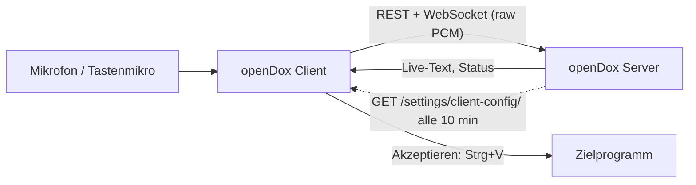

# openDox Client: Funktionsweise

> Stand: 2026-10-08 · Client-Version 0.8.1 · Server ab 0.8.3
> Der Client liegt in einem eigenen Repository (`opendox-client`, Go + Wails v2,
> AGPL-3.0-or-later). Dieses Dokument beschreibt, wie er mit dem Server
> zusammenarbeitet. Details zu Build, Berechtigungen und Plattformen stehen in
> der README und der `AGENTS.md` des Client-Repos.

## 1. Rolle im Gesamtsystem

Der Client ist ein schmales **Always-on-top-Overlay** für Windows, macOS und
Linux. Er ersetzt nicht das Web-Frontend, sondern ergänzt es: Diktiert wird in
einem beliebigen anderen Programm (Praxissoftware, Mail, Editor), der Client
bleibt dabei sichtbar und fügt den fertigen Text dort ein.



Der Client enthält keine Spracherkennung und kein Sprachmodell. Transkription,
Term-Korrektur, PII-Maskierung und Zusammenfassung laufen vollständig auf dem
Server (siehe [`opendox.md`](opendox.md), [`pii.md`](pii.md)). Er verwendet
dieselbe API wie das Web-Frontend, nur mit eigener Zwischenschicht:

- Das **Go-Backend** hält keinen Auth-Zustand. Es hängt das Token an Aufrufe, die
  es im Auftrag des Frontends macht (`GoCreateRecord`, `GoGetWSURL`,
  `GoInsertTranscript` …), und übernimmt alles mit Betriebssystembezug:
  globale Hotkeys, Zwischenablage, Tastatureingabe, HID-Geräte,
  WebView-Berechtigungen, OIDC-Loopback.
- Das **React-Frontend** enthält die eigentliche Logik: Login, Recorder,
  Kategorie-Auswahl, Anzeige.

## 2. Server-Adresse und Konfiguration

Die Server-URL steht zur Laufzeit in einer `settings.json`, nichts ist
einkompiliert. Gesucht wird zuerst neben dem Programm (unter Windows etwa
`C:\Program Files\openDox\settings.json`, nur mit Adminrechten änderbar), dann
im Benutzer-Konfigordner (`%AppData%\opendox-client`,
`~/Library/Application Support/opendox-client`, `~/.config/opendox-client`).
Fehlt die Datei, gilt `http://localhost:10000`.

```json
{ "server_url": "https://opendox.example.org/opendox" }
```

`http://` wird für den WebSocket zu `ws://`, `https://` zu `wss://`. Ein
`ROOT_PATH` des Servers gehört in die URL.

Der Server erzeugt diese Datei fertig: **Admin → Clients** zeigt Installer-Links
(neuestes GitHub-Release des Client-Repos, der Server speichert selbst keine
Installer), die `settings.json` mit der eigenen Adresse und ausgefüllte
Intune-/SCCM-Befehle (`GET /api/v1/settings/client-distribution/`). Die Adresse
leitet er aus der Anfrage des Admins ab. Mit `CLIENT_SERVER_URL` lässt sie sich
fest vorgeben, mit `CLIENT_DOWNLOAD_BASE_URL` die Quelle der Installer.

## 3. Anmeldung

| Weg | Ablauf |
|---|---|
| Passwort (lokal oder LDAP) | `POST /api/v1/auth/login`, der JWT liegt im `localStorage` des WebViews |
| OIDC/SSO | Nativer Loopback-Flow nach RFC 8252: Der Client öffnet einen Listener auf `127.0.0.1` mit zufälligem Port und zufälligem Callback-Pfad, startet den Systembrowser mit `/api/v1/auth/oidc/login` und bekommt die Tokens als Event zurück (5 Minuten Timeout, nur ein Versuch gleichzeitig). Der Login findet nie im eingebetteten WebView statt. |

Nach der Anmeldung gilt dieselbe Pflicht-Bestätigung „Kein Medizinprodukt“ wie
im Web-Frontend (`User.disclaimer_accepted_at`).

## 4. Aufnahme-Ablauf

1. **Session anlegen:** `POST /api/v1/records/create` mit Kategorie, oder
   Wiederaufnahme einer unfertigen Session (der Server hält den Zustand in
   `session_store`).
2. **WebSocket:** `/api/v1/records/ws/record` mit Token in der Query. Der Client
   sendet rohes Float32-PCM (16 kHz, mono) aus einem `AudioWorklet`.
3. **Live-Text:** Der Server leitet das Audio an Parakeet weiter und liefert
   `partial` (offenes Segment) und `text`/`cleanup` (stabiler Text) zurück.
4. **Stop:** Der Client sendet `{"event":"stop"}`. Die Server-Meldung
   `status: finished` bedeutet nur, dass die **Hintergrundverarbeitung
   gestartet** ist (Whisper, Term-Korrektur, optional Sanitizer, LLM).
5. **Ergebnis:** Der Client fragt `GET /api/v1/records/status/{task_id}` ab, bis
   die Aufgabe abgeschlossen ist (Sicherheits-Timeout 90 s), und zeigt dann den
   Text an.

Schließt der Client ohne Stop (Absturz, Netzwerk), behält der Server die Session
zur Wiederaufnahme. Ein geschlossener Socket heißt nicht „fertig“.

### Live-Ansicht aus

`live_view=false` (Server-Richtlinie, im Overlay pro Rechner per Auge-Symbol
überschreibbar) zeigt nur einen Orb statt des Live-Texts. Der Client hängt dann
`?live=0` an die WebSocket-URL, und der Server startet für diese Session keine
Live-Transkription. Das Audio wird trotzdem aufgezeichnet, das Endergebnis
nach dem Stop ändert sich nicht. Ältere Server ignorieren den Parameter.

## 5. Bedienung

| Linux/Windows | macOS | Aktion |
|---|---|---|
| `Strg+Alt+R` | `Cmd+Option+R` | Aufnahme starten/stoppen |
| `Strg+Alt+P` | `Cmd+Option+P` | Pausieren/fortsetzen |
| `Strg+Alt+V` | `Cmd+Option+V` | Akzeptieren und einfügen |
| `Strg+Alt+H` | `Cmd+Option+H` | Overlay ein-/ausblenden |
| `Strg+Alt+D` (halten) | `Cmd+Option+D` | Push-to-Talk: halten = aufnehmen, loslassen = stoppen und einfügen |

**Diktiermikrofone** (Philips SpeechMike, Nuance PowerMic) werden per HID
angesprochen und lösen dieselben Ereignisse aus. Im Modus `hold` (Standard) ist
die Record-Taste Push-to-Talk, im Modus `toggle` startet und stoppt der
Tastendruck. Die Byte-Offsets der Tasten sind bisher nicht an echter Hardware
verifiziert (`ODX_DICTATION_MIC_DEBUG=1` protokolliert die Rohdaten).

**Kategorie:** Die Auswahl wird pro Benutzer gemerkt. Fehlt die gemerkte
Kategorie, nimmt der Client die Kategorie „Allgemein“. Die Kategorie lässt
sich nachträglich ändern (`PUT /record/{id}`), der Server fasst dann neu
zusammen.

## 6. Text ins Zielprogramm einfügen

Der Text wird **nie automatisch kopiert**. Er verlässt den Client nur über den
Akzeptieren-Schritt (Button, `Strg+Alt+V` oder Mikrofontaste); im
Overlay ist er nicht markierbar, ein Kontextmenü gibt es nicht.

1. Der Client legt den Text in die Zwischenablage.
2. Er simuliert `Strg+V` (macOS: `Cmd+V` über `CGEventPost`). In Citrix-Sitzungen
   unter Windows tippt er stattdessen Zeichen für Zeichen.
3. Eine Desktop-Benachrichtigung erinnert an die Prüfung.

**Hold-Modus:** Beim Loslassen der Mikrofontaste (oder `Strg+Alt+D`) wird der
Text nach der Verarbeitung ohne weiteren Klick eingefügt. Die Prüfung findet
dann im Zielprogramm statt, bevor der Anwender dort speichert oder abschickt.

### Schutz der Zwischenablage (Windows)

- Der Text wird als „nicht in Verlauf/Cloud aufnehmen“ markiert (kein Win+V,
  keine Cloud-Zwischenablage). Gelingt das nicht, bricht das Einfügen ab.
- Nach `clipboard_clear_after_seconds` (Standard 30) wird die Zwischenablage
  geleert, aber nur, wenn der Anwender in der Zwischenzeit nichts anderes
  kopiert hat. Ebenso beim Beenden des Clients.
- Das Overlay zeigt an, **in welches Programm** eingefügt wird („Einfügen in: …“).
  Fenstertitel werden weder geloggt noch gespeichert, weil sie Patientennamen
  enthalten können.
- Eine optionale Allow-Liste (`insert_allowlist`) lässt den Client vor dem
  Einfügen in nicht gelistete Programme nachfragen. Standardmäßig ist sie leer,
  weil der Client auch als allgemeines Diktierwerkzeug dient.

macOS und Linux nutzen die normale Zwischenablage ohne Markierung und ohne
automatisches Leeren.

## 7. Zentrale Client-Richtlinie

Der Admin legt unter **Admin → Clients** fest, wie sich alle Clients dieses
Servers verhalten. Gespeichert ist das in der Tabelle `clientsettingsmodel`.

| Schlüssel | Standard | Wirkung |
|---|---|---|
| `live_view` | `true` | Live-Text oder nur Orb |
| `dictation_mic_mode` | `hold` | Push-to-Talk oder Toggle |
| `clipboard_exclude_from_history` | `true` | Verlauf/Cloud ausschließen (Windows) |
| `clipboard_clear_after_seconds` | `30` | Zwischenablage leeren, `0` = nie (Windows) |
| `insert_allowlist` | leer | Zielprogramme ohne Rückfrage (Windows) |

Der Client ruft `GET /api/v1/settings/client-config/` beim Start und danach alle
10 Minuten ab. Der Endpunkt braucht **bewusst keinen Login**, weil der Client
die Werte schon vor der Anmeldung braucht; der Inhalt ist nicht geheim.
`PUT` ist Admin-only. Der letzte Stand wird pro Server-URL im Cache-Ordner des
Benutzers gespeichert (`client-policy-cache.json`) und gilt, wenn der Server
beim Start nicht erreichbar ist.

**Vorrang:** Server-Werte schlagen die lokale `settings.json`. Eine bewusst
leere Server-Allow-Liste schaltet auch eine lokale ab. Die lokalen Schlüssel
gelten nur, solange der Client noch nie einen Serverstand hatte, oder bei einem
Server ohne diesen Endpunkt.

## 8. Verteilung

| Plattform | Artefakt | Hinweis |
|---|---|---|
| Windows | `opendox-client-installer.msi`, `opendox-client-amd64-installer.exe` | Rollout per Intune/SCCM/GPO, `settings.json` neben die `.exe` legen (Details im Client-Repo: `build/windows/installer/DEPLOYMENT.md`) |
| macOS | `opendox-client-macos.zip` | Braucht Mikrofon, Bedienhilfen, Eingabeüberwachung; für dauerhafte Freigaben muss der Build mit einem echten Apple-Zertifikat signiert sein |
| Linux | selbst bauen | `libwebkit2gtk-4.1`, `libusb`, optional `libnotify-bin` |

Die Dateinamen sind fest, weil der Server auf
`releases/latest/download/<Name>` verlinkt. Ein Release entsteht mit
`scripts/release.sh <version>` im Client-Repo. Solange das Repo privat ist,
funktionieren die Links nur für angemeldete GitHub-Nutzer mit Zugriff.

## 9. Datenschutz-Bezug

- Audio und Text gehen **ausschließlich an den konfigurierten openDox-Server**.
  Der Client sendet keine Telemetrie und ruft keine Drittdienste auf.
- Auf dem Rechner liegen nur Token (WebView-`localStorage`), `settings.json`,
  der Richtlinien-Cache und kurzzeitig der Text in der Zwischenablage.
  Das Transkript wird nicht auf Platte gespeichert.
- Die Zwischenablage ist der einzige Weg, auf dem Patiententext den Client
  verlässt. Windows-Schutz siehe Abschnitt 6, auf macOS und Linux gibt es ihn nicht.
- Die Datenflüsse des Servers stehen in [`data-mapping.md`](data-mapping.md),
  die des Clients in `docs/data-mapping.md` im Client-Repo.

## 10. Bekannte Grenzen

- Hotkeys scheitern, wenn das Betriebssystem die Kombination belegt (z. B.
  `Strg+Alt+D` unter Xfce) oder unter macOS die Eingabeüberwachung fehlt. Der
  Client warnt dann im Overlay.
- Wird das Fenster minimiert, pausiert das WebView seine Abfragen und das
  automatische Einfügen stockt. Deshalb gibt es keinen Minimieren-Knopf; zum
  Wegblenden dient `Strg+Alt+H`.
- Zwischenablage-Schutz, Allow-Liste und „Einfügen in: …“ gibt es nur unter
  Windows.
- Die Tasten-Offsets der Diktiermikrofone sind nicht an echter Hardware geprüft.

## Verwandte Dokumente

- [`zweckbestimmung.md`](zweckbestimmung.md): Zweck und Abgrenzung zur MDR
- [`opendox.md`](opendox.md): Serverarchitektur und API
- Im Client-Repo: `README.md`, `AGENTS.md`, `DISCLAIMER.md`, `docs/opendox-client.md`
