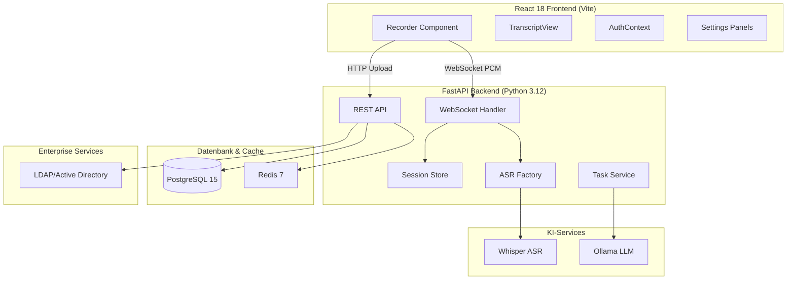
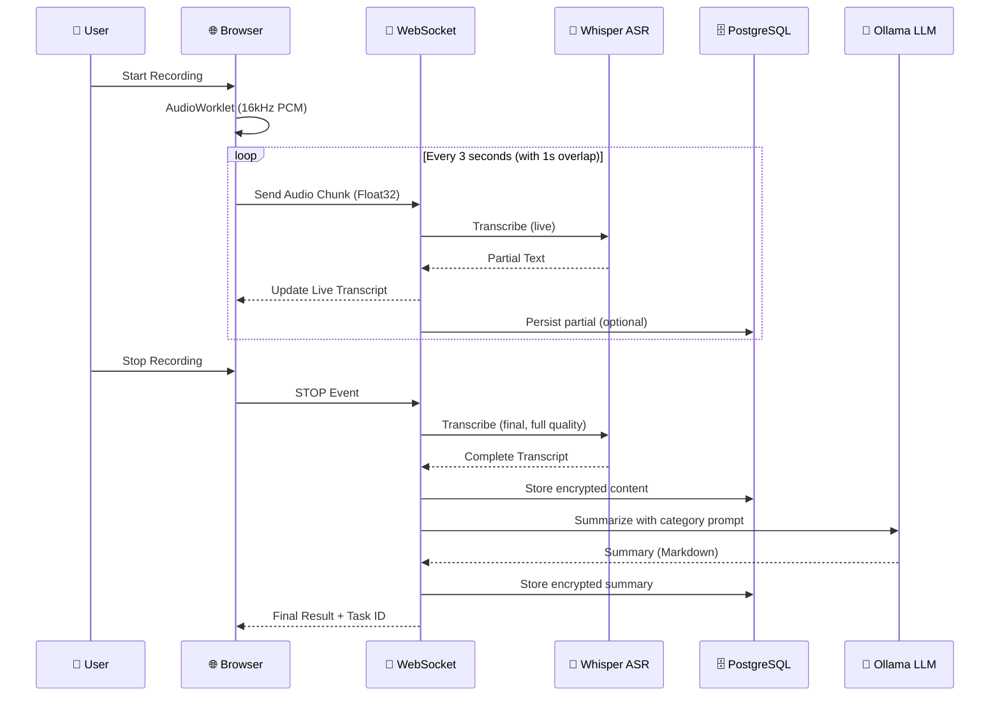
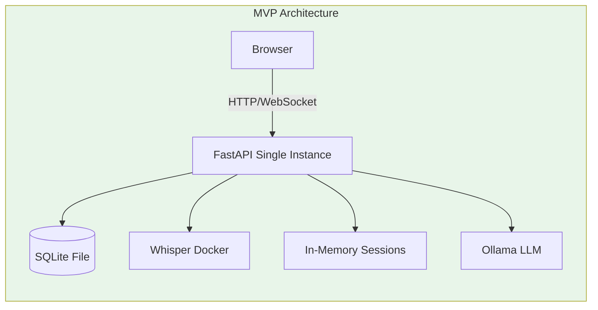
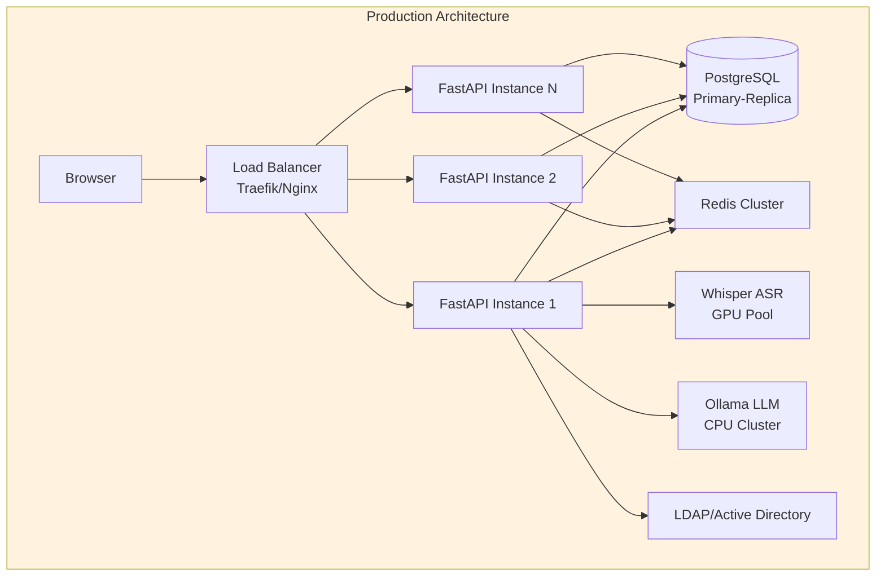

# openDox – Medizinische Transkriptionsplattform

> **AGPL-3.0-or-later** | Copyright (C) 2025 Christopher Abanilla <christopher.abanilla@gmx.de>
> 
> Dieses Programm ist freie Software: Sie können es unter den Bedingungen der GNU Affero General Public License weiterverteilen und/oder modifizieren.

---

## Projektvision

**openDox** ist eine moderne, webbasierte Plattform für medizinische Transkription, entwickelt für Praxen, Kliniken und medizinische Versorgungszentren (MVZs). Die Anwendung ermöglicht medizinischem Fachpersonal die sprachgesteuerte Dokumentation von Patientendaten mittels KI-gestützter Spracherkennung und automatischer Zusammenfassung.

### Kernfeatures

- 🎤 **Near-Live Transkription**: WebSocket-basierte Spracherkennung mit <1s Latenz
- 🤖 **KI-Zusammenfassung**: Automatische Grammatikkorrektur und Strukturierung
- 🔐 **DSGVO-konform**: Feldweise Verschlüsselung für patientenbezogene Daten
- 🏢 **Enterprise-Ready**: LDAP-Integration, Redis-Sessions, horizontale Skalierung
- 🐳 **Cloud-Native**: Docker-basierte Deployment mit PostgreSQL

---

## Systemarchitektur

### High-Level Architektur



### Transkriptions-Pipeline (Near-Live)



---

## Tech-Stack

### Backend

| Komponente | Technologie | Version | Zweck |
|------------|-------------|---------|-------|
| **Web Framework** | FastAPI | ≥0.122.0 | REST API, WebSocket |
| **ORM** | SQLModel | ≥0.0.27 | Datenbank-Mapping |
| **Migrationen** | Alembic | ≥1.15.2 | Schema-Management |
| **Datenbank** | PostgreSQL | 15 | Primärspeicher |
| **Fallback-DB** | SQLite3 | - | Development |
| **Auth** | python-jose + bcrypt | ≥3.5.0 | JWT-Token |
| **LDAP** | ldap3 | ≥2.9.1 | Enterprise-Auth |
| **LLM-Client** | LangChain | ≥1.2.0 | LLM-Orchestrierung |
| **Verschlüsselung** | cryptography (Fernet) | - | Feldweise Encryption |
| **Audio** | ffmpeg | System | Chunk-Merging |
| **Server** | Uvicorn | ≥0.38.0 | ASGI-Server |

### Frontend

| Komponente | Technologie | Version | Zweck |
|------------|-------------|---------|-------|
| **Framework** | React | 18.3.1 | UI-Komponenten |
| **Language** | TypeScript | ≥5.8.3 | Typsicherheit |
| **Build** | Vite | ≥5.4.19 | Dev-Server, Bundling |
| **UI-Kit** | shadcn/ui | - | Radix-basierte Components |
| **Styling** | Tailwind CSS | ≥3.4.17 | Utility-First CSS |
| **State** | React Context | - | Auth, Theme |
| **Data Fetching** | TanStack Query | ≥5.83.0 | Server-State |
| **Markdown** | react-markdown | ≥10.1.0 | Summary-Rendering |
| **Icons** | lucide-react | ≥0.462.0 | Icon-Set |

---

## Near-Live Streaming: Implementation

### Frontend: AudioWorklet (Recorder.tsx)

Die Audio-Erfassung erfolgt über den `AudioWorklet` für maximale Performance und direkten Zugriff auf PCM-Daten:

```typescript
// Recorder.tsx - AudioWorklet Implementation
const workletCode = `
  class PCMProcessor extends AudioWorkletProcessor {
    process(inputs, outputs, parameters) {
      const input = inputs[0];
      if (input.length > 0) {
        // Sende rohes Float32 (4 Byte pro Sample) direkt an das Backend
        this.port.postMessage(input[0].buffer);
      }
      return true;
    }
  }
  registerProcessor("pcm-worklet", PCMProcessor);
`;

// Chunk-Berechnung für optimale Latenz
const SAMPLE_RATE = 16000;        // 16kHz (Whisper-optimal)
const BYTES_PER_SAMPLE = 4;       // Float32
const CHUNK_DURATION_S = 3;       // 3 Sekunden
const OVERLAP_S = 1;              // 1 Sekunde Überlappung

const bytesPerChunk = CHUNK_DURATION_S * SAMPLE_RATE * BYTES_PER_SAMPLE;     // 192 KB
const bytesPerOverlap = OVERLAP_S * SAMPLE_RATE * BYTES_PER_SAMPLE;          // 64 KB

// Inline Worklet-Code laden
const blob = new Blob([workletCode], { type: "application/javascript" });
const workletUrl = URL.createObjectURL(blob);
await audioCtx.audioWorklet.addModule(workletUrl);

const source = audioCtx.createMediaStreamSource(stream);
const worklet = new AudioWorkletNode(audioCtx, "pcm-worklet");

// Float32 → WebSocket
worklet.port.onmessage = (e) => {
  if (socketRef.current?.readyState === WebSocket.OPEN) {
    socketRef.current.send(e.data); // ArrayBuffer (Float32)
  }
};
```

**Hintergrund:** WebM-Encoding wäre ineffizient, da Whisper ohnehin PCM erwartet. Der AudioWorklet ermöglicht direkte Verarbeitung ohne Format-Konvertierung.

### Frontend: Parallel-Upload für finale Datei

```typescript
// MediaRecorder für WebM-Chunks (alle 10s)
const mediaRecorder = new MediaRecorder(stream, { mimeType: "audio/webm" });

mediaRecorder.ondataavailable = (e) => {
  if (e.data.size > 0 && sessionIdRef.current) {
    uploadChunk(e.data, sessionIdRef.current);
  }
};

mediaRecorder.onstop = async () => {
  // Warte auf alle Uploads vor STOP-Event
  await Promise.all(Array.from(activeUploadsRef.current));
  socketRef.current?.send(JSON.stringify({ event: "stop" }));
};

// Upload-Funktion mit Promise-Tracking
const uploadChunk = (chunk: Blob, sessionId: string) => {
  const formData = new FormData();
  formData.append("file", chunk, `chunk_${Date.now()}_${sessionId}.webm`);
  formData.append("session_id", sessionId);
  formData.append("user_id", userId);

  const promise = fetch("/api/v1/records/upload-chunk", {
    method: "POST",
    body: formData
  }).finally(() => activeUploadsRef.current.delete(promise));

  activeUploadsRef.current.add(promise);
};
```

### Backend: WebSocket Handler (record.py)

```python
@record_bp.websocket("/ws/record")
async def websocket_record(websocket: WebSocket, db: SessionDep):
    await websocket.accept()
    
    session_id = websocket.query_params.get("session_id")
    user_id = websocket.query_params.get("user_id")
    
    # Session-State initialisieren
    session = session_store.get_by_session(session_id)
    if session is None:
        session = session_store.create_session(
            user_id=int(user_id),
            session_id=session_id,
            record_id=record.id,
            title=record.title,
            category_id=record.category_id,
        )
    
    # Audio-Buffer für finale Transkription
    session["audio_buffer"] = bytearray()
    session["last_index"] = 0
    session["live_text"] = ""
    
    try:
        while True:
            msg = await websocket.receive()
            
            if msg.get("bytes"):
                chunk = msg["bytes"]
                session["audio_buffer"].extend(chunk)
                
                # Live-ASR alle 3s mit Overlap
                buffer_len = len(session["audio_buffer"])
                new_data_len = buffer_len - session["last_index"]
                
                if new_data_len >= bytes_per_chunk:
                    start = session["last_index"]
                    end = start + bytes_per_chunk
                    audio_slice = bytes(session["audio_buffer"][start:end])
                    
                    # Overlap für nächsten Chunk (vermeidet Wortabbrüche)
                    session["last_index"] = end - bytes_per_overlap
                    
                    # Non-blocking Transkription
                    backend = get_live_asr()
                    result_text = await asyncio.to_thread(
                        backend.transcribe,
                        audio=audio_slice,
                        language="de",
                        prompt=session["live_text"] or None,  # Context-Prompting
                    )
                    
                    if result_text:
                        session["live_text"] = (session["live_text"] + " " + result_text).strip()
                        
                        # Push zu Browser
                        await websocket.send_json({
                            "session_id": session_id,
                            "text": result_text
                        })
    
    except Exception as e:
        logger.error(f"[WS-ERROR] {e}")
    
    finally:
        if stopped:
            # Finale Verarbeitung (FFmpeg Merge + Background-Task)
            await merge_and_process(session_id, user_id)
```

### Latenz-Profil

```
┌─────────────────────────────────────────────────────────────┐
│  ⚡ NEAR-LIVE LATENZ-PROFIL                                 │
│  ─────────────────────────────────────────────────────────  │
│  Komponente              │ Latenz      │ Optimierung       │
│  ────────────────────────┼─────────────┼──────────────────  │
│  Audio-Capture (Browser) │   10-20ms   │ 16kHz direkt      │
│  WebSocket RTT           │    5-10ms   │ Lokales Netzwerk  │
│  ASR-Inferenz (3s Chunk) │ 600-900ms   │ GPU (CUDA)        │
│  Response-Serialization  │    5-10ms   │ JSON minimal      │
│  ────────────────────────┼─────────────┼──────────────────  │
│  Gesamt (Time-to-Text)   │  ~825-940ms │ Ziel: <500ms      │
│                                                                 │
│  🔧 Optimierungspotenzial:                                      │
│  • Whisper-Turbo Modell (2x schneller, -5% Accuracy)           │
│  • Chunk auf 2s reduzieren (höhere CPU-Last)                   │
│  • Streaming-ASR mit Word-Level-Streaming                      │
└─────────────────────────────────────────────────────────────┘
```

**Warum 3s-Chunks?**
- Whisper arbeitet am effizientesten mit 30s-Segmenten
- Für Live-Transkription: Kompromiss zwischen Latenz und Qualität
- 1s-Overlap verhindert Wortabbrüche an Chunk-Grenzen

---

## Enterprise: Redis Session-Store

### Current State: In-Memory (session_store.py)

```python
class SessionStore:
    """In-memory session store for active recordings.
    
    TODO: Replace with Redis for production/multi-instance deployments.
    """
    
    def __init__(self):
        self._sessions: Dict[int, Dict[str, Any]] = {}  # user_id -> session_data
        self._session_to_user: Dict[str, int] = {}      # session_id -> user_id
    
    def create_session(self, user_id, session_id, record_id, title, category_id=None):
        session_data = {
            "session_id": session_id,
            "user_id": user_id,
            "record_id": record_id,
            "title": title,
            "category_id": category_id,
            "created_at": datetime.now(),
            "last_activity": datetime.now(),
            "status": "recording",
            "audio_buffer": bytearray(),  # Für finale Transkription
            "last_index": 0,              # Fortschritt für Overlap
            "live_text": "",              # Akkumuliertes Live-Transkript
        }
        
        self._sessions[user_id] = session_data
        self._session_to_user[session_id] = user_id
        return session_data
    
    def append_audio(self, session_id: str, chunk: bytes) -> None:
        """Append raw audio bytes to the session's live buffer."""
        session = self.get_by_session(session_id)
        if session is not None:
            session["audio_buffer"].extend(chunk)
```

### Probleme der In-Memory-Lösung

| Problem | Auswirkung | Lösung |
|---------|------------|--------|
| ❌ Datenverlust bei Restart | Unfertige Aufnahmen gehen verloren | Redis Persistence (AOF) |
| ❌ Kein Multi-Instance | Load-Balancing unmöglich | Redis Cluster |
| ❌ Memory-Leak | Sessions nie aufgeräumt | Redis TTL (30 Min) |
| ❌ Keine Shared State | Websocket auf anderer Instance findet Session nicht | Redis als zentraler Store |

### Target State: Redis-Implementation

```python
# session_store_redis.py - Production-ready
import redis
import json
from typing import Optional, Dict, Any

class RedisSessionStore:
    """Production-ready session store with Redis backend.
    
    Features:
    - Multi-instance support (shared state across all instances)
    - Automatic TTL (30 minutes)
    - Persistence across restarts (AOF)
    - Horizontal scaling (Redis Cluster)
    """
    
    def __init__(self, redis_url: str = "redis://redis:6379/0"):
        self.redis = redis.from_url(redis_url)
        self.ttl_seconds = 1800  # 30 minutes
    
    def create_session(
        self,
        user_id: int,
        session_id: str,
        record_id: int,
        title: str,
        category_id: Optional[int] = None
    ) -> Dict[str, Any]:
        """Create session with automatic TTL."""
        session_data = {
            "session_id": session_id,
            "user_id": user_id,
            "record_id": record_id,
            "title": title,
            "category_id": category_id,
            "created_at": datetime.now().isoformat(),
            "last_activity": datetime.now().isoformat(),
            "status": "recording",
            "last_index": 0,
            "live_text": "",
        }
        
        key = f"session:{user_id}"
        
        # Store metadata as JSON
        self.redis.hset(key, mapping={
            "metadata": json.dumps(session_data),
        })
        
        # Store audio buffer as binary (separate key for performance)
        self.redis.set(f"session:{user_id}:audio", b"")
        
        # Set TTL
        self.redis.expire(key, self.ttl_seconds)
        self.redis.expire(f"session:{user_id}:audio", self.ttl_seconds)
        
        return session_data
    
    def append_audio(self, user_id: int, chunk: bytes) -> None:
        """Append audio chunk efficiently (binary append)."""
        self.redis.append(f"session:{user_id}:audio", chunk)
        self.redis.expire(f"session:{user_id}:audio", self.ttl_seconds)
    
    def get_audio_buffer(self, user_id: int) -> bytes:
        """Retrieve full audio buffer."""
        return self.redis.get(f"session:{user_id}:audio") or b""
    
    def set_live_state(self, user_id: int, last_index: int, live_text: str) -> None:
        """Update live transcription progress."""
        key = f"session:{user_id}"
        session = self.get_session(user_id)
        if session:
            session["last_index"] = last_index
            session["live_text"] = live_text
            session["last_activity"] = datetime.now().isoformat()
            self.redis.hset(key, mapping={"metadata": json.dumps(session)})
    
    def delete_session(self, user_id: int) -> bool:
        """Cleanup all session data."""
        self.redis.delete(f"session:{user_id}")
        self.redis.delete(f"session:{user_id}:audio")
```

### Docker-Integration

```yaml
# docker-compose.yml - Redis Service
services:
  redis:
    image: redis:7-alpine
    container_name: opendox-redis
    restart: always
    command: redis-server --appendonly yes --save 60 1
    volumes:
      - redis-data:/data
    healthcheck:
      test: ["CMD", "redis-cli", "ping"]
      interval: 5s
      timeout: 5s
      retries: 5

  app:
    environment:
      REDIS_URL: redis://redis:6379/0
    depends_on:
      redis:
        condition: service_healthy

volumes:
  redis-data:
    name: opendox-redis-data
```

### Migration Guide

```bash
# Schritt 1: Redis Container starten
docker compose up -d redis

# Schritt 2: Python Redis-Client installieren
uv pip install redis

# Schritt 3: Session-Store austauschen (backend/run.py)
# Before:
# from backend.components.services.session_store import session_store

# After:
from backend.components.services.session_store_redis import RedisSessionStore
session_store = RedisSessionStore()

# Schritt 4: Environment setzen
echo "REDIS_URL=redis://redis:6379/0" >> .env

# Schritt 5: App neu starten
docker compose restart app
```

---

## Enterprise: LDAP Integration

### LDAP-Service (ldap.py)

```python
# ldap.py - Enterprise Authentication Service
from ldap3 import Server, Connection, ALL, Tls
from typing import Dict, Optional

class LdapService:
    """LDAP authentication service for enterprise environments.
    
    Supports:
    - Active Directory
    - OpenLDAP
    - FreeIPA
    """
    
    def __init__(self, settings: LdapSettingsModel):
        # SSL/TLS Configuration
        tls = Tls(validate=ssl.CERT_REQUIRED) if settings.use_ssl else None
        
        self.server = Server(
            settings.server_url,
            get_info=ALL,
            use_ssl=settings.use_ssl,
            tls=tls
        )
        self.bind_dn = settings.bind_dn
        self.bind_password = settings.bind_password
        self.user_search_base = settings.user_search_base
        self.user_filter = settings.user_filter
    
    def authenticate(self, username: str, password: str) -> Dict:
        """Authenticate user against LDAP server."""
        try:
            # Build user DN from filter template
            user_filter = self.user_filter.format(username=username)
            
            # Connect with admin/service credentials
            conn = Connection(
                self.server,
                self.bind_dn,
                self.bind_password,
                auto_bind=True
            )
            
            # Search for user
            conn.search(
                self.user_search_base,
                user_filter,
                attributes=['dn', 'mail', 'displayName']
            )
            
            if len(conn.entries) == 0:
                return {"success": False, "error": "User not found"}
            
            user_dn = conn.entries[0].dn
            
            # Verify password with user DN
            user_conn = Connection(self.server, user_dn, password)
            if user_conn.bind():
                user_conn.unbind()
                return {
                    "success": True,
                    "email": str(conn.entries[0].mail),
                    "display_name": str(conn.entries[0].displayName)
                }
            else:
                return {"success": False, "error": "Invalid password"}
                
        except Exception as e:
            return {"success": False, "error": str(e)}
```

### Auth-Endpoints mit LDAP-Fallback

```python
# auth_routes.py - Login mit LDAP-Integration
@auth_bp.post("/login", response_model=Token)
async def login(user_in: UserLogin, db: SessionDep):
    # 1. Lokale Authentifizierung versuchen
    stmt = select(User).where(User.name == user_in.name)
    user = db.exec(stmt).first()
    
    if user and user.hashed_password:
        if verify_password(user_in.password, user.hashed_password):
            access_token = create_access_token(sub=str(user.id))
            refresh_token = create_refresh_token(sub=str(user.id))
            return Token(access_token=access_token, refresh_token=refresh_token)
    
    # 2. LDAP Login (Fallback)
    stmt_ldap = select(LdapSettingsModel)
    ldap_settings = db.exec(stmt_ldap).first()
    
    if ldap_settings:
        ldap_service = LdapService(ldap_settings)
        auth_result = ldap_service.authenticate(user_in.name, user_in.password)
        
        if auth_result["success"]:
            # Auto-Provisioning: Neuen Benutzer anlegen
            if not user:
                user = User(
                    name=user_in.name,
                    hashed_password="",  # Kein Passwort für LDAP-User
                    is_active=True,
                )
                db.add(user)
                db.commit()
                db.refresh(user)
            
            access_token = create_access_token(sub=str(user.id))
            refresh_token = create_refresh_token(sub=str(user.id))
            return Token(access_token=access_token, refresh_token=refresh_token)
    
    raise HTTPException(
        status_code=status.HTTP_401_UNAUTHORIZED,
        detail="Incorrect name or password",
    )
```

### LDAP Settings Model

```python
# models/ldap_model.py
class LdapSettingsModel(SQLModel, table=True):
    id: Optional[int] = Field(primary_key=True)
    server_url: str = "ldap://ldap.example.com:389"
    use_ssl: bool = False
    base_dn: str = "dc=example,dc=com"
    bind_dn: str = "cn=admin,dc=example,dc=com"
    bind_password: str  # Verschlüsselt speichern!
    user_search_base: str = "ou=users,dc=example,dc=com"
    # OpenLDAP Format:
    user_filter: str = "(uid={username})"
    # Active Directory Alternative:
    # user_filter = "(sAMAccountName={username})"
```

### Vergleich: Local vs. LDAP

```
┌─────────────────────────────────────────────────────────────┐
│  🔐 AUTHENTICATION COMPARISON                               │
│  ─────────────────────────────────────────────────────────  │
│                                                               │
│  Feature                │ Local Auth │ LDAP Integration     │
│  ───────────────────────┼────────────┼──────────────────────  │
│  Setup Complexity       │ ✅ Simple  │ ⚠️  Moderate          │
│  Password Management    │ ❌ Manual  │ ✅ Centralized        │
│  Multi-System Login     │ ❌ Per App │ ✅ Single Sign-On     │
│  Password Policies      │ ❌ Basic   │ ✅ Enterprise         │
│  User Provisioning      │ ❌ Manual  │ ✅ Auto-Sync          │
│  MFA Support            │ ❌ Custom  │ ✅ Built-in           │
│  Offline Capability     │ ✅ Yes     │ ⚠️ Cached only        │
│  Compliance (GDPR)        │ ⚠️ Self    │ ✅ Audit-ready        │
│                                                               │
│  🎯 Recommendation:                                           │
│  • <10 Users: Local Auth sufficient                          │
│  • 10-100 Users: LDAP recommended                            │
│  • >100 Users: LDAP + SSO (SAML/OIDC) required              │
└─────────────────────────────────────────────────────────────┘
```

---

## 🔒 Datenbankverschlüsselung (DSGVO-konform)

### Fernet-Verschlüsselung (field_encryption.py)

```python
# field_encryption.py - Transparent Field Encryption
from cryptography.fernet import Fernet, InvalidToken
from sqlalchemy import String
from sqlalchemy.types import TypeDecorator
from config import env_or_file

# Key aus Environment oder Docker Secrets
_raw_key = env_or_file("ENCRYPTION_KEY", None)

if _raw_key is None:
    logger.warning(
        "ENCRYPTION_KEY is not set — patient data will be stored unencrypted. "
        "Set ENCRYPTION_KEY to a Fernet key for DSGVO compliance. "
        "Generate one with: python -c \"from cryptography.fernet import Fernet; print(Fernet.generate_key().decode())\""
    )
    _fernet = None
else:
    _fernet = Fernet(_raw_key.encode() if isinstance(_raw_key, str) else _raw_key)


def encrypt(value: str) -> str:
    """Encrypt a string using Fernet symmetric encryption."""
    if _fernet is None or not value:
        return value
    return _fernet.encrypt(value.encode()).decode()


def decrypt(value: str) -> str:
    """Decrypt a Fernet-encrypted string. Falls back to plaintext for unencrypted legacy data."""
    if _fernet is None or not value:
        return value
    try:
        return _fernet.decrypt(value.encode()).decode()
    except (InvalidToken, Exception):
        # Old plaintext record — return as-is to allow gradual migration
        return value


class EncryptedString(TypeDecorator):
    """SQLAlchemy column type that transparently encrypts on write and decrypts on read.
    
    Usage:
        content: str = Field(sa_column=Column(EncryptedString, nullable=False))
    
    The encryption is transparent to the application layer:
    - Write: Plaintext → Encrypted (automatic)
    - Read: Encrypted → Plaintext (automatic)
    """
    
    impl = String
    cache_ok = True
    
    def process_bind_param(self, value, dialect):
        """Called when writing to database."""
        if value is None:
            return value
        return encrypt(value)
    
    def process_result_value(self, value, dialect):
        """Called when reading from database."""
        if value is None:
            return value
        return decrypt(value)
```

### Anwendung in Record-Model

```python
# record_model.py
from sqlalchemy import Column
from backend.components.security.field_encryption import EncryptedString

class Record(SQLModel, table=True):
    """Medical record with encrypted patient data."""
    
    id: Optional[int] = Field(default=None, primary_key=True)
    session_id: str = Field(index=True)
    user_id: int
    title: str
    
    # 🔒 VERSCHLÜSSELT: Patientenbezogene Daten
    content: str = Field(sa_column=Column(EncryptedString, nullable=False, default=""))
    summarize: str = Field(sa_column=Column(EncryptedString, nullable=False, default=""))
    
    # Unverschlüsselt (kein medizinischer Inhalt)
    timestamp: str
    file: str
    archived: bool = Field(default=False)
```

### Key-Management

```bash
# 1. Fernet-Key generieren
python -c "from cryptography.fernet import Fernet; print(Fernet.generate_key().decode())"

# Output: b'your-key-here...'

# 2. Als Environment Variable setzen
export ENCRYPTION_KEY="your-key-here..."

# 3. Oder in Docker Secret
# echo "your-key-here..." | docker secret create encryption_key -

# 4. Oder in .env Datei
echo "ENCRYPTION_KEY=your-key-here..." >> .env

# 5. Mit Docker Secrets (empfohlen)
# docker-compose.yml
secrets:
  encryption_key:
    file: ./secrets/encryption_key

services:
  app:
    secrets:
      - encryption_key
    environment:
      ENCRYPTION_KEY_FILE: /run/secrets/encryption_key
```

### DSGVO-Compliance

```
┌─────────────────────────────────────────────────────────────┐
│  🛡️  DSGVO-COMPLIANCE                                       │
│  ─────────────────────────────────────────────────────────  │
│                                                               │
│  ✅ Verschlüsselung bei Speicherung (Art. 32 DSGVO)          │
│     - Patientenbezogene Felder (content, summarize)           │
│     - AES-128 im Fernet-Format (symmetrisch)                │
│     - Token-basierte Verschlüsselung (Pseudonymisierung)    │
│                                                               │
│  ✅ Zugriffskontrolle (Art. 32 DSGVO)                         │
│     - JWT-basierte Authentifizierung                        │
│     - LDAP-Integration für Enterprise-Umgebungen             │
│     - Superuser-Flag für Admin-Funktionen                   │
│                                                               │
│  ✅ Vertraulichkeit (Art. 5 DSGVO)                           │
│     - Field-level encryption (nicht nur DB-Verschlüsselung)  │
│     - Memory-safe: Key nie im Code, nur in Environment       │
│     - Fallback auf Plaintext für Migration (abwärtskompatibel)│
│                                                               │
│  ⚠️  TODO: Dokumentation (Art. 30 DSGVO)                     │
│     - Verzeichnis von Verarbeitungstätigkeiten (VVT)        │
│     - Datenfluss-Dokumentation                                │
│                                                               │
│  ⚠️  TODO: Audit-Logging (Art. 5 DSGVO)                      │
│     - Wer hat wann auf welche Patientendaten zugegriffen?    │
│     - Unveränderbare Logs (Write-once storage)              │
│                                                               │
└─────────────────────────────────────────────────────────────┘
```

### Technische Details

**Algorithmus:** Fernet (AES-128 in CBC mode mit HMAC)

**Was ist verschlüsselt?**
- `Record.content` – Transkript (patientenbezogene Gespräche)
- `Record.summarize` – LLM-Zusammenfassung (patientenbezogene Inhalte)

**Was ist NICHT verschlüsselt?**
- `Record.title` – Titel der Aufnahme (administrativ)
- `Record.timestamp` – Zeitstempel (Metadaten)
- `User.name` – Benutzername (Referenz für Zugriffskontrolle)

**Warum Feldweise Verschlüsselung?**
- 🔍 **Suche erhalten:** Nicht-verschlüsselte Felder bleiben durchsuchbar
- 📊 **Analytics:** Metadaten für Statistiken nutzbar
- 🔄 **Migration:** Abwärtskompatibel (Fallback auf Plaintext)

---

## Architecture Evolution

### Phase 1: MVP (Current State)



**Charakteristika:**
- ✅ Single-instance deployment
- ✅ SQLite für einfaches Setup
- ✅ In-Memory Sessions (schnell, aber nicht persistent)
- ✅ Keine externen Abhängigkeiten außer Whisper/Ollama
- ⚠️ Keine Hochverfügbarkeit
- ⚠️ Datenverlust bei Server-Restart

**Geeignet für:**
- Einzelpraxen (< 5 Benutzer)
- Proof-of-Concept
- Development/Testing

### Phase 2: Production (Target State)



**Enhancements:**
- ✅ Horizontal scaling (multiple FastAPI instances)
- ✅ Session persistence (Redis Cluster)
- ✅ Database replication (PostgreSQL Primary-Replica)
- ✅ High availability (no single point of failure)
- ✅ Enterprise authentication (LDAP/Active Directory)
- ✅ Load balancing (Traefik or Nginx)
- ✅ Production-grade logging & monitoring

**Geeignet für:**
- Mittelgroße Praxen (10-50 Benutzer)
- Kliniken und MVZs
- Multi-Standort-Deployments

### Migrations-Roadmap

```
┌─────────────────────────────────────────────────────────────┐
│  🗺️  ENTERPRISE MIGRATION ROADMAP                          │
│  ─────────────────────────────────────────────────────────  │
│                                                               │
│  Phase 1: Foundation (Week 1-2)                              │
│  ├─ Docker-Compose für Redis einrichten                    │
│  ├─ Session-Store auf Redis migrieren                      │
│  ├─ PostgreSQL als Primary DB konfigurieren               │
│  └─ Health-Check Endpoints implementieren                    │
│                                                               │
│  Phase 2: Authentication (Week 3-4)                          │
│  ├─ LDAP-Service implementieren                            │
│  ├─ Fallback-Logik (Local → LDAP) testen                   │
│  ├─ User-Sync und Auto-Provisioning                         │
│  └─ SSL/TLS für LDAP konfigurieren                         │
│                                                               │
│  Phase 3: High Availability (Week 5-6)                       │
│  ├─ Load-Balancer (Traefik) aufsetzen                      │
│  ├─ Multi-Instance Deployment (Docker Swarm/K8s)          │
│  ├─ PostgreSQL Replication konfigurieren                    │
│  └─ Redis Cluster für HA-Sessions                          │
│                                                               │
│  Phase 4: Observability (Week 7-8)                           │
│  ├─ Prometheus Metrics exportieren                         │
│  ├─ Grafana Dashboards erstellen                             │
│  ├─ Structured Logging (JSON Format)                       │
│  ├─ Alerting Rules (Slack/Email/PagerDuty)                 │
│  └─ Backup-Strategie testen (Disaster Recovery)            │
└─────────────────────────────────────────────────────────────┘
```

---

## Production Readiness Checklist

```
┌─────────────────────────────────────────────────────────────┐
│  🚀 PRODUCTION READINESS CHECKLIST                           │
│  ─────────────────────────────────────────────────────────  │
│                                                               │
│  SECURITY 🔐                                                 │
│  ├─ [✅] JWT Authentication                                 │
│  ├─ [✅] LDAP Integration                                   │
│  ├─ [✅] Field Encryption (Fernet)                          │
│  ├─ [✅] HTTPS Enforcement (Reverse-Proxy)                   │
│  ├─ [⚠️ ] Rate-Limiting (TODO: nginx/slowapi)              │
│  ├─ [⚠️ ] Audit-Logging (TODO: who accessed what when)      │
│  └─ [⚠️ ] CSP Headers (TODO: Content-Security-Policy)       │
│                                                               │
│  RELIABILITY 🛡️                                              │
│  ├─ [✅] Health-Check Endpoints (/api/endpoint)             │
│  ├─ [⚠️ ] Readiness Probes (TODO: DB/Redis connection)      │
│  ├─ [✅] Redis Session Store                                │
│  ├─ [⚠️ ] Circuit Breaker (TODO: for external services)   │
│  └─ [⚠️ ] Retry Logic (TODO: exponential backoff)          │
│                                                               │
│  SCALABILITY 📈                                               │
│  ├─ [✅] Stateless Application                              │
│  ├─ [✅] Redis for Sessions                               │
│  ├─ [⚠️ ] Load-Balancer Config (TODO: Traefik)              │
│  └─ [⚠️ ] Auto-Scaling Rules (TODO: K8s HPA)               │
│                                                               │
│  MONITORING 📊                                                │
│  ├─ [✅] Basic Logging (Python stdlib)                     │
│  ├─ [⚠️ ] JSON Structured Logs (TODO: pythonjsonlogger)   │
│  ├─ [⚠️ ] Prometheus Metrics (TODO: prometheus-fastapi)   │
│  ├─ [⚠️ ] Grafana Dashboards (TODO: import dashboard)     │
│  └─ [⚠️ ] Alerting (TODO: Alertmanager rules)               │
│                                                               │
│  BACKUP & RECOVERY 💾                                         │
│  ├─ [✅] PostgreSQL Volume                                │
│  ├─ [⚠️ ] Automated Backups (TODO: pg_dump cron)          │
│  ├─ [⚠️ ] Backup Testing (TODO: monthly restore test)     │
│  └─ [⚠️ ] Disaster Recovery Plan (TODO: documented)       │
│                                                               │
│  COMPLIANCE 📋                                                │
│  ├─ [✅] AGPL-3.0 License Headers                         │
│  ├─ [✅] Field Encryption for PHI                         │
│  ├─ [⚠️ ] VVT Documentation (TODO: Art. 30 DSGVO)         │
│  └─ [⚠️ ] Data Processing Agreement (TODO: DPA)           │
│                                                               │
└─────────────────────────────────────────────────────────────┘

Legend:
[✅] Implemented and tested
[⚠️ ] TODO or needs improvement
```

---

## API-Referenz

### Authentication

| Methode | Pfad | Beschreibung | Auth |
|---------|------|--------------|------|
| POST | `/api/v1/auth/register` | Benutzer registrieren | ❌ |
| POST | `/api/v1/auth/login` | Login (lokal + LDAP) | ❌ |
| POST | `/api/v1/auth/refresh` | Token refreshen | ❌ |
| GET | `/api/v1/auth/me` | Aktueller Benutzer | ✅ |
| GET | `/api/v1/auth/users` | Benutzerliste (Admin) | ✅ (Superuser) |
| POST | `/api/v1/auth/users` | Benutzer erstellen (Admin) | ✅ (Superuser) |
| PUT | `/api/v1/auth/users/{id}` | Benutzer updaten (Admin) | ✅ (Superuser) |
| DELETE | `/api/v1/auth/users/{id}` | Benutzer löschen (Admin) | ✅ (Superuser) |

### Records

| Methode | Pfad | Beschreibung | Auth |
|---------|------|--------------|------|
| POST | `/api/v1/records/create` | Neue Aufnahme erstellen | ✅ |
| GET | `/api/v1/records/active-session/{user_id}` | Aktive Session abrufen | ✅ |
| DELETE | `/api/v1/records/cancel-session/{user_id}` | Session abbrechen | ✅ |
| WS | `/api/v1/records/ws/record` | WebSocket für Live-Transkript | ✅ |
| POST | `/api/v1/records/upload-chunk` | Audio-Chunk hochladen | ✅ |
| GET | `/api/v1/records/list-records/{user_id}` | Aufnahmen auflisten | ✅ |
| GET | `/api/v1/records/record/{record_id}` | Einzelne Aufnahme | ✅ |
| PUT | `/api/v1/records/record/{record_id}` | Aufnahme updaten | ✅ |
| DELETE | `/api/v1/records/record/{record_id}` | Aufnahme löschen | ✅ |
| PUT | `/api/v1/records/record/{id}/archive` | Archivieren | ✅ |
| PUT | `/api/v1/records/record/{id}/unarchive` | De-Archivieren | ✅ |
| GET | `/api/v1/records/by-session/{session_id}` | Nach Session-ID suchen | ✅ |
| GET | `/api/v1/records/status/{task_id}` | Task-Status | ✅ |

### Settings (Admin only)

| Methode | Pfad | Beschreibung |
|---------|------|--------------|
| GET | `/api/v1/settings/whisper-settings/` | Whisper-Konfiguration |
| PUT | `/api/v1/settings/whisper-settings/` | Whisper updaten |
| GET | `/api/v1/settings/llm-settings/` | LLM-Konfiguration |
| PUT | `/api/v1/settings/llm-settings/` | LLM updaten |
| GET | `/api/v1/settings/ldap-settings/` | LDAP-Konfiguration |
| PUT | `/api/v1/settings/ldap-settings/` | LDAP updaten |

---

## Entwicklungsbefehle

### Backend

```bash
# Environment kopieren
cp .env.example .env

# Dependencies installieren (mit uv)
uv pip install -r pyproject.toml

# Development Server starten
python -m uvicorn main:app --reload --host 0.0.0.0 --port 5000

# ⚠️ Wichtig: Nie "uv run main.py" verwenden (führt zu double init!)

# Datenbank-Migrationen
alembic upgrade head

# Neue Migration erstellen
alembic revision --autogenerate -m "Beschreibung"
```

### Frontend

```bash
cd frontend

# Dependencies installieren
npm install

# Development Server (Port 3000, Proxy zu :5000)
npm run dev

# Production Build (Output: frontend/dist/)
npm run build

# Preview Build
npm run preview
```

### Docker (Production)

```bash
# Gesamter Stack (PostgreSQL + Whisper + App)
docker compose up --build

# Nur spezifische Services
docker compose up -d postgres
docker compose up -d redis

# Logs ansehen
docker compose logs -f app

# Container stoppen
docker compose down

# Mit Volumes löschen (⚠️ Datenverlust)
docker compose down -v
```

---

## Bekannte Probleme & Lösungen

### 1. Dev-Server: `python -m uvicorn main:app`

❌ **Falsch:** `uv run main.py` (führt zu double init)  
✅ **Richtig:** `python -m uvicorn main:app --reload --host 0.0.0.0 --port 5000`

**Grund:** `main.py` importiert `create_app()` und ruft `uvicorn.run()` nur bei `__main__` auf.

### 2. Port 9000 Konflikt (Whisper)

Port 9000 ist oft von Jupyter belegt.

**Lösung:**
```yaml
# docker-compose.yml
ports:
  - "9100:9000"  # Host:Container
```

### 3. Whisper Settings: DB priorisiert ENV

DB-Werte überschreiben `.env`. Bei Stale Settings:

**Lösungen:**
1. Settings UI verwenden (`/settings`)
2. DB zurücksetzen: `DELETE FROM whisper_settings_model;`
3. Server neu starten

### 4. WebSocket-Proxy (Vite)

Frontend verwendet `window.location.host` für WebSocket.

**Vite-Config:**
```javascript
// vite.config.ts
export default defineConfig({
  server: {
    proxy: {
      '/api/v1/': {
        target: 'http://localhost:5000',
        changeOrigin: true,
        secure: false,
        ws: true,  // WebSocket-Upgrade
      },
    },
  },
});
```

### 5. LLM: Fresh Instance per Task

❌ **Falsch:** Singleton `OllamaModel()`  
✅ **Richtig:** `OllamaModel()` in `background_transcription_service.py` neu erstellen

**Grund:** Settings-Updates werden sonst nicht übernommen.

### 6. HTTPS für Microphone

Browser erfordern HTTPS für Microphone-Zugriff (außer localhost).

**Lösung:**
```python
# backend/run.py
@app.middleware("http")
async def add_permissions_policy(request: Request, call_next):
    response = await call_next(request)
    response.headers["Permissions-Policy"] = "microphone=(self)"
    return response
```

---

## Ressourcen

### Repositories

- **Quellcode:** [GitHub - openDox](https://github.com/christopherabanilla/openDox)
- **Docker Images:** Docker Hub
- **Dokumentation:** Diese Datei (opendox.md)

### Technologie-Dokumentation

- [FastAPI](https://fastapi.tiangolo.com/)
- [SQLModel](https://sqlmodel.tiangolo.com/)
- [Alembic](https://alembic.sqlalchemy.org/)
- [React](https://react.dev/)
- [shadcn/ui](https://ui.shadcn.com/)
- [Whisper](https://github.com/openai/whisper)
- [Ollama](https://ollama.com/)

---

## Danksagung

Entwickelt von **Christopher Abanilla** für den Einsatz in medizinischen Praxen und Kliniken.

Besonderer Dank an die Open-Source-Community:

- **Sebastián Ramírez** – FastAPI
- **Tiangolo** – SQLModel
- **shadcn** – shadcn/ui
- **OpenAI** – Whisper
- **Ollama Team** – Lokale LLM-Inferenz

---

## Lizenz

```
openDox - Medical transcription platform
Copyright (C) 2025 Christopher Abanilla <christopher.abanilla@gmx.de>

This program is free software: you can redistribute it and/or modify
it under the terms of the GNU Affero General Public License as published by
the Free Software Foundation, either version 3 of the License, or
(at your option) any later version.

This program is distributed in the hope that it will be useful,
but WITHOUT ANY WARRANTY; without even the implied warranty of
MERCHANTABILITY or FITNESS FOR A PARTICULAR PURPOSE. See the
GNU Affero General Public License for more details.

You should have received a copy of the GNU Affero General Public License
along with this program. If not, see <https://www.gnu.org/licenses/>.
```

---

*Letzte Aktualisierung: Juni 2025*  
*Version: 0.1.0*
