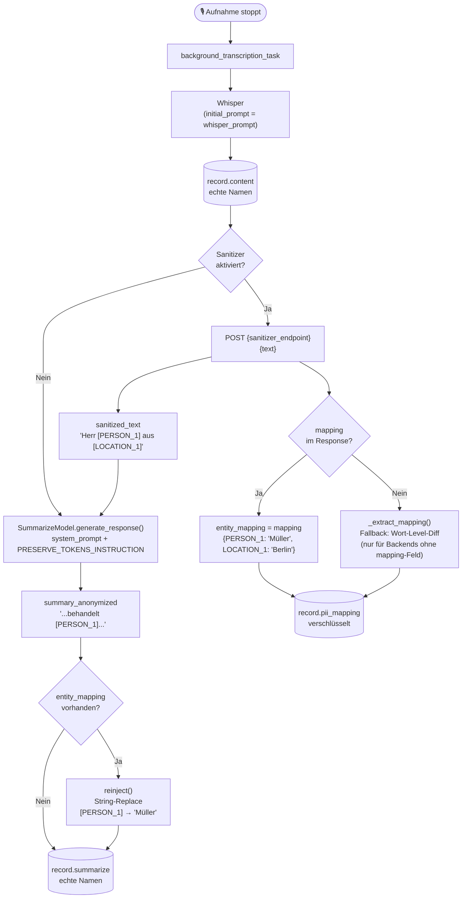

# PII-Sanitizer Pipeline

Flussdiagramm des Verarbeitungswegs wenn der EntityGuard-Sanitizer aktiviert ist.



`generate_response()` (`llm_model.py`) hängt zusätzlich zu `PRESERVE_TOKENS_INSTRUCTION`
unconditional eine Anti-Halluzinations-Regel an **jeden** Prompt an (nicht nur
bei aktivem Sanitizer) — sie verbietet dem Modell, neue eckige-Klammer-Platzhalter
(z. B. `[DATUM]`) für fehlende Informationen zu erfinden, ist aber bewusst so
formuliert, dass sie bestehende EntityGuard-Token wie `[PERSON]`/`[LOCATION]`
ausdrücklich ausnimmt — sonst würden sich beide Instruktionen widersprechen
(siehe Alembic-Revision `a599665d9034`).

## Felder in der Datenbank

| Feld | Inhalt | Verschlüsselt |
|---|---|---|
| `record.content` | Vollständiges Transkript mit echten Namen | ✅ |
| `record.pii_mapping` | JSON-Mapping `{[TOKEN]: "Original"}` | ✅ |
| `record.summarize` | Zusammenfassung mit re-injizierten echten Namen | ✅ |

## Konfiguration

Admin-UI → LLM-Einstellungen → PII-Sanitizer (EntityGuard)

- **Endpoint:** vollständige URL des Sanitize-Endpunkts, z.B.
  `http://entityguard:9500/api/v1/sanitize` — es wird kein Pfad
  mehr automatisch angehängt, damit auch andere Sanitizer-Dienste mit
  abweichender Route konfiguriert werden können.
- **API Key:** optional, Bearer Token
- **Department:** wird nicht mehr vom Backend gesendet (EntityGuard wendet
  intern einen Default an)

## Response-Contract

Bevorzugt liefert der Sanitizer-Endpunkt das Mapping direkt mit:

```json
{
  "sanitized_text": "Herr [PERSON_1] aus [LOCATION_1]",
  "mapping": {"[PERSON_1]": "Müller", "[LOCATION_1]": "Berlin"}
}
```

Fehlt das `mapping`-Feld (z.B. bei einem einfacheren/älteren Sanitizer-Backend,
das nur `sanitized_text` liefert), rekonstruiert `_extract_mapping()` in
`sanitizing_service.py` das Mapping per Wort-Level-Diff zwischen Original- und
sanitisiertem Text. Dieser Fallback ist best-effort und **verwirft absichtlich
mehrdeutige Treffer**: enthält ein zusammenhängender Diff-Block mehrere direkt
aneinanderliegende Tokens ohne trennenden Originaltext, wird dieser Block
übersprungen und eine Warnung geloggt, statt eine Zuordnung zu raten (falsches
Demasking — Patient A bekommt Patient B's Daten — wäre schlimmer als ein nicht
zurückübersetzter Token).

**Wichtig für den Sanitizer-Dienst:** Tokens müssen pro Vorkommen eindeutig
sein (z.B. `[PERSON_1]`, `[PERSON_2]` statt zweimal `[PERSON]`), sonst
kollidieren mehrere Vorkommen derselben Kategorie im Mapping-Dict — das gilt
sowohl für den direkten `mapping`-Contract als auch für den Diff-Fallback.

## Fallback-Verhalten

- **Sanitizer nicht erreichbar:** Task geht auf `error` (fail-closed — kein ungesicherter LLM-Call)
- **LLM paraphrasiert Token:** Token geht im Summary verloren, `record.content` enthält immer den vollständigen Originaltext
- **Sanitizer deaktiviert:** `record.content` wird direkt ans LLM übergeben, `record.pii_mapping` bleibt `NULL`
- **Mehrdeutiger Diff-Block (nur Fallback-Pfad):** Block wird übersprungen und geloggt, betroffene Tokens bleiben im Summary stehen, werden aber nicht demaskiert
